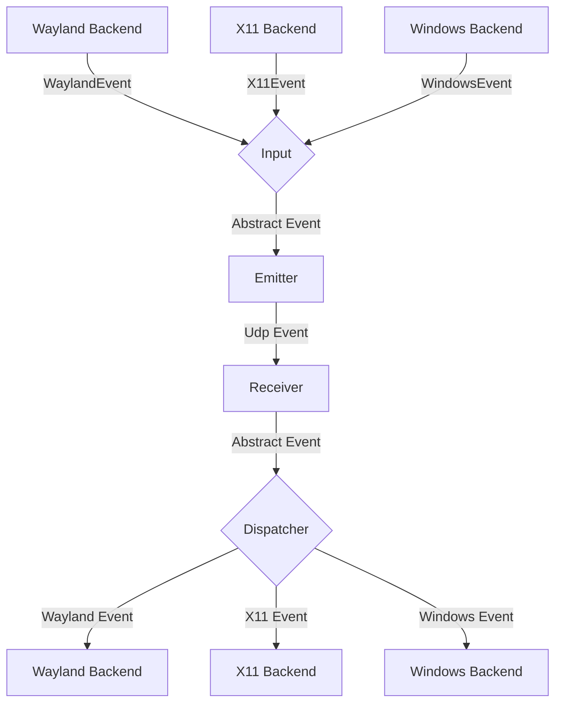
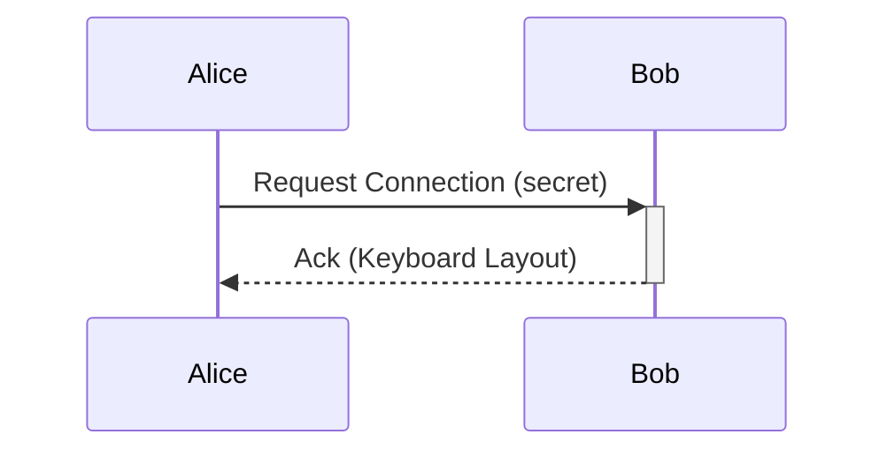

# General Software Architecture

## Dedicated conversations

The fixed top navigation opens Messages, Files, Devices, or Settings.
Messages has a visible device sidebar, a scrollable conversation, and a fixed
bottom composer. Each device keeps a separate in-memory draft. Identity discovery
preserves the selected recipient and draft. Files offers file/folder selection,
drag-and-drop, the receive directory and transfer records. Starting a transfer
opens that page. Devices puts IP enrollment and sharing controls before layout;
authorization, ports and appearance live in Settings.
Incoming bubbles align left and outgoing bubbles right; text is selectable,
links and image previews remain actionable. Conversations use peer identity,
not display names; duplicate labels show an identity suffix. Unconfigured peers
remain readable, with sending disabled until a configured device is available.
Unread counts appear on the Messages tab and device sidebar, including when the
window is hidden or inactive. Returning to the active conversation clears its
unread count. Clearing all conversations requires confirmation. Records
still last only for the current daemon run; the protocol remains v7.

`python3 tests/conversation_ui_smoke.py` runs the native GTK main-thread harness
with isolated preferences/IPC, checks identity transitions, independent drafts,
sending, inactive-window unread state and clearing, and captures all four pages
in English/light and Chinese/dark plus a compact window.
It does not use the user's clipboard or enable login startup.

## Joining by main-device IP (protocol v7)

Select **Show connection IP** on the main device, enter its IPv4 address on each
other device, and compare/approve the certificate fingerprints on both screens.
The host distributes the approved group (at most three devices), input ports
and data endpoints. Followers trust membership updates only from that host
over the normal authenticated data channel, with increasing revisions.
The enrollment host is independent of the selected keyboard primary.
When no remote device is configured and no group has been joined, the primary
button also offers **Show connection IP** instead of starting an empty sharing
session. It opens the Devices page and starts joining mode. The advertised IP
is displayed in large selectable text, with instructions for the other devices;
the host's join-address input is hidden while hosting. After devices connect,
use the primary button to start keyboard/mouse sharing. An unavailable local
IPv4 or failed listener is shown explicitly.

TCP 4244 is open only while joining mode is active. Its restricted TLS
transport proves possession of the displayed certificates but grants no file,
clipboard or input access before both confirmations. Frames are bounded to
4096 bytes, confirmations to 120 seconds, and concurrent host handshakes to four.
Normal data/input certificate pinning remains required. Stop pairing cancels
pending approvals and closes the listener; existing approved connections remain.
Group addresses and trust persist in local config and restore on restart.
Updates and restoration preserve existing clients' enabled/disabled state.
Joining reads the host's current input port; a port change during confirmation
rejects that attempt before authorization, and the peer can join again.
Successful input-port changes persist and propagate through the host. A follower
may propose only its own input port at the current group revision; the host
validates it and publishes a new revision. Other membership/endpoint edits from
followers are rejected. Pending local changes are retried after reconnect or a
new host snapshot. Rebuild all devices to use this update behavior.
Removing a member on the host propagates revocation; local follower revocation
also disables future automatic membership updates from that host.

Joining mode lists the host's IPv4 addresses on separate selectable lines,
including hotspot adapters. Loopback, link-local, unspecified, multicast and
broadcast addresses are excluded, and duplicate addresses are removed.
Choose the address on the joining device's network. For a Windows mobile
hotspot, this is usually `192.168.137.1`, rather than the host's upstream
Ethernet address. Virtual adapter addresses may also appear; listing an address
does not guarantee that another device can reach it. Stop and restart joining
mode after changing adapters to refresh the list.
Rejected groups distinguish capacity (three devices including the host),
duplicate IP/port endpoints, invalid identities and existing authorization
conflicts. Review unused authorizations explicitly; pairing never clears them
automatically.
If addresses change, repeat joining against the same host to refresh them.
All devices must run v7; v6 packages do not implement this enrollment flow.

### Nearby main devices

While joining mode is active, the host announces itself once per second with a
UDP broadcast on port 4245 from each listed IPv4 address (limited broadcast and
the address's /24 directed broadcast). The announcement carries only the
computer name and the enrollment TCP port; the joining device uses the packet's
source address. Other devices list announcements seen in the last five seconds
(at most 16) under **Nearby main devices**, showing the computer name and IP.
Selecting **Connect** sends the same join request as typing that IP.
Announcements are unauthenticated and grant nothing: fingerprints are still
compared and approved on both devices. Manual IP entry remains available when
broadcasts are blocked, for example by router client isolation, VPNs or
subnets other than /24 with a firewall that drops limited broadcast. If UDP
4245 is in use, the list stays empty and manual entry still works.

## Resident app and test packages

The GUI hides on window close on macOS/Windows and retains its window state.
The native menu bar/notification icon exposes Open, Stop sharing and Quit.
`Shutdown` ends the daemon through the same input release and
temporary message cleanup path as Ctrl+C. `cli quit` waits up to eight seconds
for the IPC stream to close. GUI disconnects exit normally; an owned child has
an eight-second cleanup bound before forced termination. Startup IPC retries
have a ten-second bound. `--hidden` is used for login launches.

UI preferences default login startup to enabled. macOS writes one per-user
LaunchAgent without KeepAlive; Windows writes one HKCU Run value. Disabling
removes registration. Automated fixtures set `LAN_MOUSE_DISABLE_AUTOSTART=1`.
Windows uses a session mutex to forward repeated launches to `PresentWindow`.

The daemon holds up to 500 text/image message events in memory and sends a
`Messages` snapshot during frontend synchronization. GTK replaces its record
from that snapshot. `ClearImageMessages` now clears both kinds of messages and
broadcasts `MessagesCleared` without changing the system clipboard. Quitting clears
run messages, including temporary image files.

Package scripts, installation/permissions and user acceptance are documented
in [installation](docs/安装与卸载.md) and [three-device testing](docs/三机测试清单.md).
macOS packages bundle dylibs and GTK runtime data and verify ad-hoc signatures.
Windows scripts stage DLLs, VC CRT, schemas, icons and image loaders, check the
dependency closure and build a per-user Inno Setup installer. Windows compilation
and installer acceptance remain pending. The manual Test packages workflow uploads
artifacts only. No distribution signing or notarization is configured.

## Authenticated data channel

Files, messages and clipboard protocol frames use a separate TLS TCP channel
(default port 4243, configurable with `data_port`). Devices must authorize each
other's certificate fingerprints. Outbound sessions additionally require the
certificate to match the requested recipient, not merely any authorized device.

The local IPC request `ConnectDataSession { device, addr }` connects to a
fingerprint at an explicit data address, including a non-default port.
`SendMessage { handle, text }` resolves the verified peer identity and reuses a live session or tries the configured
clients' IP addresses and hostnames on port 4243. This does not require input
sharing to be active. Neither request changes the clipboard. The GTK message
panel records sent/received text and links in memory, with a limit of 500
records for the current run. A successful send is reported as
`MessageSent { handle, device, message_id, text }`; `device` retains the actual
destination fingerprint so replay never resolves a recycled handle to another
peer. Restart the GUI and daemon together when updating this local IPC contract.
The network data protocol remains v7.

`CurrentTarget(Option<ClientHandle>)` reports the current outgoing input target,
separately from the `active` flag that enables a client's screen-edge barrier.
GTK shows that target in the layout and device status, after the peer acknowledges
entry. `SharingState` separately reports the selected primary and the group phase.
On the desired primary, `StartSharing` requests a session after the group has
confirmed stop. `StopSharing` immediately closes local input admission and asks
every member to release input. Screen-edge configuration is retained for reuse.

### Single-primary input sessions

The group consists of this device and all authorized fingerprints, with at most
three members. Every member must have the same group and authenticated data links.
The lowest fingerprint coordinates; this role does not determine whose keyboard
is shared. There is no automatic takeover while a member is unreachable.

The coordinator first requests native capture/emulation release from all members,
then installs a new session on all members, and only then enables the selected
primary. A process nonce and monotonic round identify each session. Restart or
connection replacement closes admission and requires a fresh stop barrier.
Native release errors prevent confirmation. `InputEmulation::destroy_checked`
and `terminate_checked` report errors; keyboard keys, modifiers and held mouse
buttons are released before a successful confirmation.

Starting sharing also requires capture on every member (including receiving
devices' return edges), and emulation on receivers. Disabled backends are retried.
Initialization errors and the 30-second readiness timeout stop sharing and report
the cause; native emulation never automatically falls back to the logging-only
dummy backend. Explicit dummy configuration remains available for tests.
macOS capture commands confirm after native state changes, preserve callback
ordering, and pump the bounded event queue while waiting. Backend failures close
the session through the group stop path.

Both input sender and receiver enforce the selected primary/session token. Native
emulation checks admission again when consuming queued events. Old unscoped input
is rejected. Control messages retain the TLS connection generation so queued
messages from replaced connections cannot restore old sessions. The data protocol
remains **v7**; restart the GUI and daemon together after upgrading.

`python3 tests/input_pipeline_smoke.py` checks motion, keyboard/button down/up,
target acknowledgement and stop through production DTLS in both primary roles,
with explicit dummy capture/emulation. `tests/native_readiness_smoke.py` checks
native Mac readiness/release without configuring input barriers or injecting
system input; the permission-denied branch runs only when permission is absent.
Neither replaces Windows/Mac input acceptance on separate computers.

File transfers wait for `FileAccepted` before sending any chunks, including
while a recipient chooses a directory/file conflict policy. `FileCommitted`
confirms receiver verification and commit; `FileRejected` reports receiver
failures, while `FileCancel` abandons a sender's transfer. Incoming state and
outgoing writers are bound to the authenticated device and TLS generation.
Pending decisions and inactive transfers expire after five minutes; connection
replacement, revocation and shutdown remove their owned temporary resources.
Each socket write has a 30-second bound. The GTK `TransferSent` event is emitted
only after the recipient's commit acknowledgement.
Write timeout removal also emits a disconnect event without blocking on a full
event queue. Filesystem preparation, commit and owned-resource cleanup run off
the async runtime thread. Non-overwriting commits use atomic exclusive rename
on macOS/Linux, without requiring hard-link support.

IPC writers use complete frames and independent bounded queues. A stalled
frontend is disconnected without blocking input or other frontends. File
selections remain queued until a registered GUI acknowledges delivery.
Clipboard followers request the current metadata snapshot on start and retry,
so independent TLS link ordering cannot permanently lose an early update.

Input handshakes discover data endpoints on port 4243. Explicit
`ConnectDataSession` addresses support custom ports. Known endpoints are retried
every three seconds, with one pending retry per device and a five-second connect
timeout. Endpoints learned only in memory are not retained across application
restart. Failure detection depends on the TCP connection; no idle heartbeat or
network-partition timing guarantee is provided.

The macOS runtime smoke test
`python3 tests/sharing_session_smoke.py --gtk` launches three isolated daemons
using real TLS and dummy input backends; it does not emulate physical multi-device
input or click GTK buttons.

### Native text and image clipboard

`ClipboardSync` integrates `ClipboardRouter` with the production service and
generation-bound TLS events. During an active sharing session, any member can
copy text or one image. The primary orders metadata and requests the body only for the current
pointer target. Remote sources send the requested body through the primary,
which applies it locally or forwards it to the current target. Other members
receive metadata/status only. Returning to the primary selects its own clipboard.

The daemon polls native change counters every 200 ms and reads contents only
when they change. The first successful read establishes a baseline and does not
publish the pre-existing clipboard. Text is limited to 128 KiB of UTF-8.
PNG/JPEG/GIF originals are limited to 16 MiB and 16,777,216 pixels, with a
16,384-pixel maximum dimension. A single image file preserves original bytes and
a portable basename, including GIF animation. macOS also converts TIFF image
content to PNG. Unsupported copies never fall back to an older text copy.
Each source keeps eight text bodies and at most eight images/64 MiB in memory.
Clipboard contents are not recorded in a persistent history.
Stopping sharing suspends network routing;
new local copies observed while stopped can be announced after sharing resumes.

Session changes, target changes and local copies invalidate pending writes.
Native reads and image preparation run on bounded worker jobs. Completed reads
are rejected if the native counter has changed. Immediately before a native write the daemon checks the native counter and
the session, request, SHA-256 and native serial without an intervening await.
Confirmed writes update the serial baseline, preventing echoes; explicitly
copying identical text again still creates a new source version. Retries run
every three seconds. `ClipboardStatus` IPC and the bilingual GTK row report
paused, waiting, syncing, ready, unavailable, unsupported or failed states.
These APIs expose no clipboard contents and add no arbitrary-target clipboard
write command. Manual messages remain independent.

macOS uses NSPasteboard changeCount and UTF-8 plain text. Access to cached
NSPasteboard objects is serialized across this process's threads; contention
returns WouldBlock for retry instead of blocking the service. NSPasteboard has no
atomic compare-and-set across processes: the counter check immediately before
clear/write narrows but cannot eliminate that OS-level race. Windows code uses
CF_UNICODETEXT, a hidden owner window, clipboard locking and sequence numbers;
embedded NULs are rejected before clearing. **Windows has not been compiled or
run in this development session.** Linux native clipboard support is outside
this fork's current scope. Native providers can delay worker reads;
polling is not a latency guarantee, and final native writes still run on the
service thread.

Images use ordered 64 KiB parts with a bounded total, authenticated source,
request/revision checks and a final SHA-256 verification. Control frames take
priority between parts; each peer retains one active and one replaceable pending
image stream. Session/target changes and local copies cancel old streams.
The target prepares a PNG representation and an immutable original file off the
input loop, then rechecks permission before writing both clipboard representations.
macOS publishes PNG plus a file URL (and original GIF/JPEG data); Windows code
publishes PNG, CF_DIBV5 with alpha masks and CF_HDROP. Windows WIC decodes preview
pixels; common 24/32-bit DIB inputs are supported in code.

Files live under the configuration directory's `clipboard-assets` folder.
Complete files are published without replacing existing originals; symbolic links
are refused. Assets persist across exit to keep native file references valid.
The cache refuses new assets above 512 MiB or 512 files. At startup,
cleanup protects the current native image and files held by
prepared writes, and removes other files older than one day. Reusing an asset
refreshes its modification time. An unknown clipboard representation or a changed
native counter makes cleanup conservative. Other apps holding an old file URL
beyond that grace period are not tracked. These files are separate from history.

`python3 tests/clipboard_session_smoke.py --gtk` uses three production daemons,
real TLS and isolated named macOS pasteboards. It verifies native copies,
handover, echo suppression, same-text recopy and pause/resume. Pointer A→B→C and
delayed completions are exercised by deterministic dispatch tests; physical
multi-machine switching and native paste shortcuts still require acceptance.
`python3 tests/image_clipboard_session_smoke.py --gtk` additionally checks a
PNG larger than 1 MiB, preserved GIF file bytes/name, application PNG and file
URL representations, TIFF normalization, multi-file rejection and no echo.
Native pixel tests cover transparent/partial/opaque alpha and stale writes.
These representation checks do not substitute for actual Finder/Explorer and
application paste acceptance; Windows remains uncompiled and untested here.
`LAN_MOUSE_TEST_PASTEBOARD` selects an isolated named pasteboard for tests; normal
operation leaves it unset.

### Clipboard privacy and image-message compatibility

There is no clipboard-history page, recording worker or history replay.
Neither local copies nor received clipboard updates create history entries.
Existing `clipboard-history` directories from older versions are left untouched
and are never loaded. Native image assets remain necessary for file-manager paste;
they are bounded temporary representations, not a browsable clipboard history.

Legacy IPC history requests remain parseable: listing returns an empty list;
copying, sending and clearing history return an unsupported-operation error.
This preserves IPC serialization without exposing old saved contents.
Restart both GUI and daemon when upgrading. The network protocol remains v7.

Receiving image messages from older peers remains supported independently of
clipboard synchronization. Two incoming assemblies use authenticated frames,
64 KiB parts, digest validation and connection-generation checks; incomplete
assemblies expire after 30 seconds. GTK displays a thumbnail and full PNG preview.
The removed history page no longer provides an image-message sending action;
images can still be transferred as files or through live clipboard sync.

A bounded worker stores image-message originals, previews and thumbnails under
`message-images` (128 MiB total, at most 500 sets). Message clearing, normal exit
and startup after a crash clean these temporary files. Old history directories
are outside this cleanup. Messages are retained only for the current daemon run.

`python3 tests/clipboard_no_history_smoke.py` exercises live text/image sync,
target handover, empty legacy listings and startup without loading or overwriting
old history, using isolated macOS named pasteboards and real TLS/DTLS sessions.
Use the [multi-device checklist](docs/三机测试清单.md) to verify these behaviors
on physical devices.

Connection and send requests run in bounded background tasks (up to 32 requests,
with separate connection/send timeouts), allowing input events and incoming messages to continue
being processed. A successful send means the frame was written to TLS, not that
the recipient application acknowledged it. A timeout leaves delivery uncertain.
Session readers and writers run independently, preserving partial frames during
bidirectional traffic. Disconnected sessions are removed; a subsequent send can
connect again. Known explicit or input-discovered data endpoints also receive
the periodic reconnect attempts described above.
Removing authorization, including via config reload, closes existing data sessions.

### File and folder transfer

`SendFiles { handle, paths }` walks each selected path and sends one transfer:
a `FileOffer` listing every entry with its size and SHA-256 digest, `FileChunk`
frames carrying at most 256 KiB each, then `FileComplete`. Every entry keeps its
own file name as the transfer root, so selecting `a/report.pdf` and `b/photos`
produces `report.pdf` plus `photos/...` instead of merging the two directories.

Sending is streaming: one chunk is read from disk at a time, so memory use does
not grow with file size. The receiver writes each chunk to a `.lanm-partial`
temporary file next to its destination while updating a running SHA-256, and
only renames it into place after the byte count and digest match the offer.
A corrupted, truncated or cancelled transfer therefore never replaces an
already complete file.

Received content is written under `receive_dir` (default
`~/Downloads/Sharemouse`, configurable in `config.toml`). Relative paths are
validated before they touch the filesystem: absolute paths, `..`, backslashes,
Windows reserved names and characters unsupported on Windows are rejected, so a
peer cannot escape the receive directory. Symbolic links are refused rather than
followed, because following them could read files outside the selected tree.

### Name conflicts and failure handling

An incoming offer is inspected before anything is written. If any destination
already exists, the daemon holds the offer and emits `TransferConflicts`; the
frontend then asks whether to overwrite, skip or keep both. `ResolveTransferConflict
{ transfer_id, policy }` answers with `overwrite`, `skip` or `rename`. Dismissing
the dialog sends no answer, which aborts that transfer rather than silently
choosing for the user.

- **Overwrite** merges a folder into the existing one: same-named files are
  replaced, new files are added, and entries only the receiver had are kept.
  A folder is never deleted and recreated.
- **Skip** keeps every existing destination and receives only the new entries.
  Chunks for skipped files still arrive and are discarded, so the sender's
  transfer completes normally.
- **Rename** receives everything under a free name (`report (1).pdf`, or
  `photos (1)/` with its whole subtree), leaving the original untouched.

Before creating any temp file the receiver also compares the announced total
size against free space in the receive directory and refuses a transfer that
cannot fit. The announced sizes come from the peer, so they are summed with
saturating addition: an absurd offer is refused rather than overflowing the
total and slipping past the check. Platforms that cannot report free space skip
this check rather than blocking the transfer.

Existing files are only replaced after a new file's size and SHA-256 both match,
so a failed or interrupted transfer never damages content that was already
complete. Interrupted transfers leave nothing but the pre-existing files: temp
files are removed on failure, cancellation and rejected offers. Resume is not
implemented; a failed transfer has to be sent again in full.

### Sending from the app

A device row offers **send files or folders**, which opens the platform's file
chooser (multi-select). Dragging files or folders onto the window stages them and
then asks which device should receive them; with a single configured device there
is nothing to choose and the transfer starts immediately.

Sending is addressed by device handle, not fingerprint: the frontend knows the
configured device, while the fingerprint is learned by the daemon inside the
input handshake (the certificate verifier records the fingerprint it accepted)
and reported to the frontend as `ClientState::peer_fingerprint`. Until a device
has connected once, its identity is unknown and sending reports that instead of
guessing an address.

Progress is reported as `TransferProgress { handle, transfer_id, sent, total,
entries }`, one event per chunk. `total` counts payload bytes only, so folders
do not leave the bar short of 100%; a still-preparing transfer reports
`total = 0` and shows no bar rather than a false 100%. A failure emits
`TransferFailed { handle, transfer_id, reason, paths }` carrying the original
selection, which is what the retry button re-sends. There is no wall-clock
timeout around a transfer, since large transfers are legitimately slow; the
connect phase and each individual send are bounded separately.

The receive folder is shown under **Transfers** and can be changed with the
system folder chooser; the daemon rejects an empty or relative path, creates the
directory eagerly, and persists the choice to `receive_dir` in `config.toml`.

### Sending from the file manager

`lan-mouse cli send [--device <name|#handle>] <path>...` sends from a terminal,
and is also what the file-manager right-click entry calls. Without `--device`
the running app asks which device should receive the selection, so the choice
happens where the device names are visible.

The two platforms deliver the selection differently, and the difference matters:

- **macOS** installs a Quick Action (`~/Library/Services/Send with
  Sharemouse.workflow`) that runs the binary as a shell action. Finder passes
  every selected item as one argument list, and `"$@"` keeps names with spaces
  and non-ASCII characters intact.
- **Windows** registers a static shell verb under
  `Software\Classes\*\shell\SharemouseSend` and the matching `Directory\shell`
  key. `MultiSelectModel` only controls whether the verb is *offered* for a
  multi-selection; the shell still starts one process per selected item.

Because of that, a right-click on five files means five short-lived processes
on Windows. `lan-mouse-cli/src/send/batch.rs` folds them back into one
transfer: each invocation writes its paths, NUL-separated, into a spool
directory under the user's cache directory, and the process that wrote the
lowest-named entry waits for a quiet period and then sends the union. Entries
older than a minute are discarded so a crashed invocation cannot block later
right-clicks.

`lan-mouse cli integration install | uninstall | status` manages the entry. Both
platforms register per user, so no elevation is needed and removal is complete.
The entry points at the installed executable, so re-running `install` after
moving the app rewrites the target.

Starting the app for a right-click is a last resort: the entry checks the IPC
socket first, and only launches the app when nothing is listening. On macOS
inside a `.app` bundle it launches through LaunchServices so the process is
registered as an application. A selection handed over while the app is still
starting is held by the daemon and collected by the window once it connects,
so a cold right-click is not lost.

Resident-window behavior, autostart, installers and real cross-platform acceptance
remain tracked follow-up work.

## Events

Each instance of lan-mouse can emit and receive events, where
an event is either a mouse or keyboard event for now.

The general Architecture is shown in the following flow chart:

### Input
The input component is responsible for translating inputs from a given backend
to a standardized format and passing them to the event emitter.

### Emitter
The event emitter serializes events and sends them over the network
to the correct client.

### Receiver
The receiver receives events over the network and deserializes them into
the standardized event format.

### Dispatcher
The dispatcher component takes events from the event receiver and passes them
to the correct backend corresponding to the type of client.

## Requests

// TODO this currently works differently

Aside from events, requests can be sent via a simple protocol.
For this, a simple tcp server is listening on the same port as the udp
event receiver and accepts requests for connecting to a device or to
request the keymap of a device.

## Problems
The general Idea is to have a bidirectional connection by default, meaning
any connected device can not only receive events but also send events back.

This way when connecting e.g. a PC to a Laptop, either device can be used
to control the other.

It needs to be ensured, that whenever a device is controlled the controlled
device does not transmit the events back to the original sender.
Otherwise events are multiplied and either one of the instances crashes.

To keep the implementation of input backends simple this needs to be handled
on the server level.

## Device State - Active and Inactive
To solve this problem, each device can be in exactly two states:

Either events are sent or received.

This ensures that
- a) Events can never result in a feedback loop.
- b) As soon as a virtual input enters another client, lan-mouse will stop receiving events,
which ensures clients can only be controlled directly and not indirectly through other clients.

