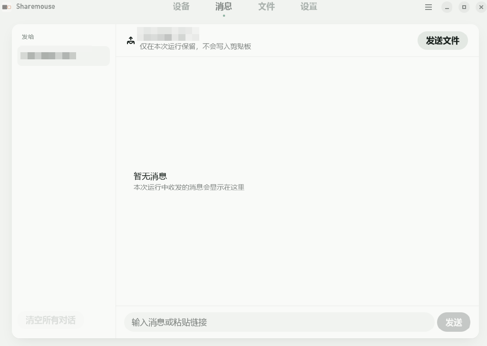
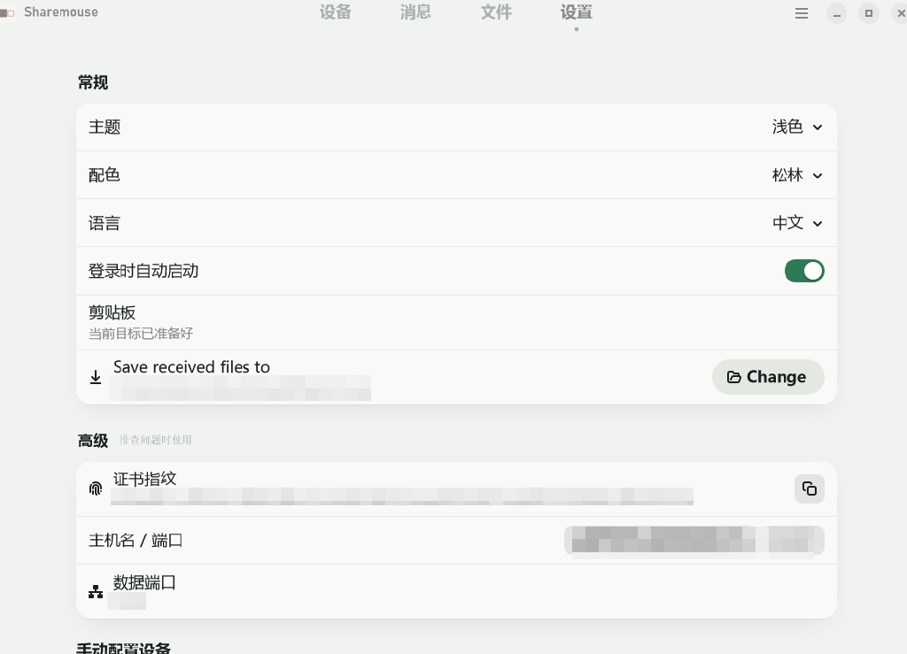

# Sharemouse

Sharemouse 是一款局域网键鼠共享工具，可让 Windows 11 和 Apple 芯片 Mac 共用一套键盘和鼠标，并支持文件、文字、图片互传和剪贴板同步。本项目基于开源项目 [Lan Mouse](https://github.com/feschber/lan-mouse) 修改。

> [!WARNING]
> 当前为实验版本，跨平台实机兼容性仍在验证中，请勿用于重要工作环境。


## 功能

- **键鼠共享**：鼠标移到屏幕边缘即可切换到另一台电脑，最多支持三台设备。
- **自动发现**：主设备打开“让其他电脑连接我”后，其他设备会在“添加设备”的“附近的电脑”中看到它的电脑名称和 IP，点击即可连接；也可手动输入 IP。
- **身份确认**：首次连接时，两台设备都要核对并确认证书指纹。键鼠、文件、消息和剪贴板传输均已加密。
- **文件互传**：支持拖拽或右键发送文件和文件夹，重名时可选择覆盖、跳过或重命名。
- **消息**：向指定设备发送文字和链接。
- **剪贴板同步**：实时同步文字和图片，不保存剪贴板历史。
- **常驻后台**：关闭窗口后最小化到托盘或菜单栏，可设置登录时自动启动。
- **中英文界面**，支持浅色和深色主题，提供暖灰橙和松林两套配色。

| 消息 | 设备与布局 |
| --- | --- |
|  |  |

## 系统要求

| 系统 | 要求 |
| --- | --- |
| Windows | Windows 11 x64 |
| macOS | Apple 芯片（M 系列）Mac |

所有设备需在同一局域网，并使用相同版本的 Sharemouse。

## 下载安装

在 [Releases](../../releases) 页面下载对应系统的安装包：

- Windows：`Sharemouse-windows-x64-setup.exe`，按当前用户安装，不需要管理员权限。
- macOS：`Sharemouse-macos-arm64.zip`，解压后把 `Sharemouse.app` 移到“应用程序”文件夹。

安装包未经过代码签名。首次运行时，Windows SmartScreen 或 macOS Gatekeeper 可能会拦截，需要手动允许。macOS 还需要在“隐私与安全性”中授予辅助功能和输入监控权限。

详细说明见 [安装与卸载](docs/安装与卸载.md)。

## 快速开始

1. 在作为主设备的电脑上打开 Sharemouse，点击“添加设备”，打开“让其他电脑连接我”。
2. 在其他电脑上点击“添加设备”，在“附近的电脑”中找到主设备，点击“连接”。
   列表为空时，在“输入对方的 IP”中手动填写主设备 IP。
3. 两台电脑都会弹出指纹确认，核对一致后点击“确认加入”。
4. 在设备页拖动屏幕，摆放成和实际位置一致。
5. 在实际连着键盘鼠标的电脑上点击“使用本机主控”，开始共享。

## 网络与防火墙

首次启动时，请允许 Sharemouse 在“专用网络”上通信。默认使用以下端口，均只在局域网内使用，不需要配置路由器端口转发：

| 端口 | 用途 |
| --- | --- |
| UDP 4242 | 键鼠输入 |
| TCP 4243 | 文件、消息和剪贴板 |
| TCP 4244 | 配对（只在等待加入期间监听） |
| UDP 4245 | 发现附近的主设备 |

如果“附近的主设备”一直为空，可能是路由器开启了 AP 隔离（客户端隔离），或者设备不在同一网段、正在使用 VPN、防火墙拦截了广播。这些情况下请手动输入 IP。使用 Windows 移动热点时，主设备 IP 一般是 `192.168.137.1`。

## 从源码构建

需要使用仓库固定的 Rust 版本（见 `rust-toolchain.toml`）以及 GTK4 和 libadwaita。

```sh
cargo build --release
```

打包 Windows 安装器和 macOS 应用的步骤见 [安装与卸载 · 开发机生成包](docs/安装与卸载.md#开发机生成包)。

开发相关文档：

- [架构与协议](DOC.md)
- [多设备测试清单](docs/三机测试清单.md)

## 许可与致谢

本项目基于 [Lan Mouse](https://github.com/feschber/lan-mouse)（作者 Ferdinand Schober 及贡献者）修改，按 [GPL-3.0-or-later](LICENSE) 许可发布，并保留上游版权与署名。
